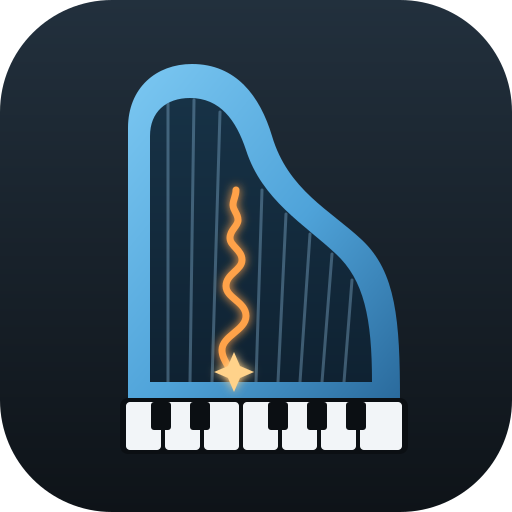

# PianoForge

A concert grand piano simulator played from a MIDI keyboard: a calibrated hybrid modal engine, with
recording of every take and technician-level settings. Cross-platform (Windows first, Linux compatible),
low latency (key to sound <= 10 ms, jitter <= 1 ms).

Status: proof of concept. The modal engine plays modes measured on a reference corpus rendered from a sampled
grand piano (unison strings and their beating, the soundboard body, a short attack residual); the listening lab
switches between that reference and the modal engine while playing.

## Layout

| Folder | Content |
|---|---|
| `engine/` | Core, pure C++20 without framework: the `pf::Engine` interface, the modal engine (complex resonator banks, AVX2), the profile loader; `modal_render` (offline renders, CPU measurements). |
| `app/` | Standalone application (JUCE 9): listening lab with an 88-key keyboard, MIDI input, audio device selection. |
| `tools/bench/` | Reference bench (Python): renders a VST3 instrument through measurement sessions and checks the takes. |
| `tools/forge/` | Forge (Python): analysis and calibration, from the reference corpus to engine data. |
| `studies/` | Standalone computations and spikes behind design decisions (resonator precision, CPU budget, resynthesis). |
| `obs/` | OBS Studio plugin: the PianoForge audio source, fed by the application through shared memory. |
| `web/` | The modal engine and the room in WebAssembly, played from a browser page. |
| `installer/` | The Windows installer (Inno Setup 6) and the update manifest it comes with. |
| `corpus/` | Rendered takes and plugin states. Local only, never committed (commercial sample library licences). |

## Build the application

Requirements: CMake >= 3.25, Visual Studio 2022 (Windows) or GCC/Ninja and the JUCE Linux dependencies (Linux).
JUCE is fetched automatically at configure time.

```
cmake --preset windows-msvc
cmake --build --preset windows-release
build/windows-msvc/app/PianoForgeApp_artefacts/Release/PianoForge.exe
```

Engine tests (no corpus needed) and headless self-test of the application (reference player, and the modal
engine when the corpus state has a profile):

```
ctest --test-dir build/windows-msvc -C Release
PianoForge.exe --selftest corpus/reference/noire-dry/single-notes selftest.txt
```

Play a MIDI file live: File > Open MIDI file (Ctrl+O), drop it on the window, or pass it on the command line
(`PianoForge.exe song.mid`). It plays to the sample with what the keyboards play, and is recorded with it.
Tracks... picks the parts to play (a part is a track's channel; drums off by default); -oct, -, +, +oct
transpose the file by semitones or octaves.

Presets saves the whole instrument under a name (the engine and its settings, the tuning, the room and the
listening position, the curves, the volume) and switches between them; Presets > Export settings / Import settings
keeps them, the curves and the rooms of one's own in a .pfsettings file (the audio device and the folders of the
computer are left out).

A safety limiter at the output (Audio > Output) keeps everything heard, recorded and streamed under -1 dBFS, with
no latency and untouched while under it.

Keyboard > Pedal curve shapes the MIDI keyboard's sustain pedal like the velocity curve (the travel it really
covers, where the half pedal falls); the Pedal button fills with the pedal's travel. Rooms and listening positions
can be saved under names of your own (Room window: Save..., Delete; Engine > Room presets).

The modal engine models each note's coupled strings (Weinreich): the soft pedal (CC67, the N key) makes the hammer
miss a string, and Engine settings > Unison tuning draws the strings together (0 %: no beating) or apart.

Record (Ctrl+R) writes the sound live as a 32-bit float WAV; when it stops, the formats ticked in File > Record
formats are made from it in the background: WAV 24-bit, FLAC 24-bit, MP3 320 kbit/s (Windows' Media Foundation
encoder), Opus 192 kbit/s; plus the MIDI, aligned to the sample. Recordings go to Documents/PianoForge/Recordings.

File > Takes and recordings (Ctrl+T) lists the takes (Ctrl+S) and the recordings together, with their date, length,
notes and files. Listen to one (Space), or to two in A/B from the same instant (A and B switch between them with a
10 ms crossfade); play one again through the engine from its MIDI, or render it again with the settings heard now (a
new WAV next to it); rename it (all its files), show it in its folder, or delete it (to the recycle bin). What is
listened to there is heard only: neither recorded again nor streamed.

When the device runs faster than 50 kHz (the Windows mixer can impose 192 kHz), the engine runs at the device's
rate divided by 2, 4 or 8 (44.1 or 48 kHz) and its sound is brought up to the device's: Audio > Engine rate.

A room around the piano, heard from a listening position (the engine's sound is the piano heard from the keyboard,
1 m away; further, the direct sound falls as 1/r, loses its highs to the air and narrows, and the room's energy
follows Barron's revised theory): the Room button in the toolbar, its settings in Engine > Room settings (Ctrl+M).
No latency on the direct sound. Heard, recorded, streamed and in take renders alike.

On headphones (Room window: Heard on, or Ctrl+H), the piano is in front of you rather than inside your head: each
side of it reaches both ears, the farther one later and duller (a spherical head: Woodworth's delay, Brown and Duda's
shadow, equalized for a source in front so that a mono sound keeps its level), the room's reflections each from
where they come, and the tail as coherent between the ears as a diffuse field. Room on or off.

In a browser (WebAssembly, the modal engine and the room, Web MIDI): see `web/README.md`.

Offline render of a MIDI file, through the reference player or the modal engine:

```
PianoForge.exe --render take.mid take.wav corpus/reference/noire-dry/single-notes [--engine modal]
```

## Install (Windows)

With Inno Setup 6 installed:

```
cmake --build --preset windows-release --target installer
```

makes `build/windows-msvc/installer/output/PianoForge-<version>-setup.exe` (the version is the project's, in the
root `CMakeLists.txt`), with `latest.json` (the update manifest) and the installer's SHA-256 next to it. The
installer holds the application, the Visual C++ runtime it needs (next to it: nothing else to install) and,
optionally, the OBS plugin (when OBS Studio is installed; a plugin OBS is using moves aside and the new one loads at
its next start). It installs for the current user without administrator rights (`%LOCALAPPDATA%\Programs\PianoForge`),
or for every user if chosen. Settings, takes and recordings are never touched, by an update or an uninstall.
It never holds the corpus nor a profile calibrated on it (the build refuses anything but its six files): the
installed application asks for its corpus (File > Change corpus). Not code-signed: Windows SmartScreen warns
about it the first time.

## Updates

Help > Update settings: the address of an update manifest (`latest.json` as written by the installer build; its
`url` may be relative to it, or set at build time with `-DPIANOFORGE_UPDATE_BASE_URL=https://...`) or of a GitHub
release (`https://api.github.com/repos/<owner>/<repo>/releases/latest`: the asset ending in `-setup.exe`, its digest
or a `.sha256` asset). https or a file; empty by default, and then nothing is looked for. Help > Check for updates,
or at start once a day if ticked. A newer version is offered (install, skip this version, later); it is downloaded
to the temporary folder, its size and SHA-256 checked, then PianoForge closes, the installer runs silently and opens
it again. `PianoForge.exe --check-update <address> report.txt` reads an address and checks its installer without
running it.

## Reference bench

```
python -m venv .venv
.venv\Scripts\python -m pip install -e tools\bench
.venv\Scripts\python -m unittest discover -s tools\bench\tests
.venv\Scripts\bench --help
```

See `tools/bench/README.md`.

## Forge

```
.venv\Scripts\python -m pip install -e tools\forge
.venv\Scripts\python -m unittest discover -s tools\forge\tests
```

| Command | Output (in the corpus state folder) |
|---|---|
| `forge release-curves` | Damper curves measured from the release takes (`release-curves.json`). |
| `forge analyze` | f0, inharmonicity, stretched tuning, decays per note; first profile (`physics.toml`). |
| `forge modes` | Every partial resolved into its modes, the unison strings and their polarisations: beating and double decay (`modes-v064.json`). |
| `forge soundboard` | The soundboard body: resonances shared by every note, amplitudes per note (`soundboard-v064.json`). Needs `forge modes`. The resonances are measured at velocity 64 and reused for the other velocities. |
| `forge export` | The modal profile played by the engine (`modal-profile.bin`), from the modes and the soundboard of every measured velocity layer, the damper curves and the attack residuals. |

The modal profile of the reference corpus takes about 1.5 hours to measure (every velocity layer), then a minute
to export:

```
for v in 8 16 24 32 40 48 56 64 72 80 88 96 104 112 120 127; do .venv/Scripts/forge modes --velocity $v; done
for v in 64 8 16 24 32 40 48 56 72 80 88 96 104 112 120 127; do .venv/Scripts/forge soundboard --velocity $v; done
.venv/Scripts/forge export
```

The profile is calibrated on a commercial library: like the corpus, it stays local and is never published.

## Licences

The engine is meant to stay under a permissive licence. The application uses JUCE (AGPLv3 or JUCE licence).
The bench uses pedalboard (GPL-3.0) as a development tool only; it is never linked into the engine.
